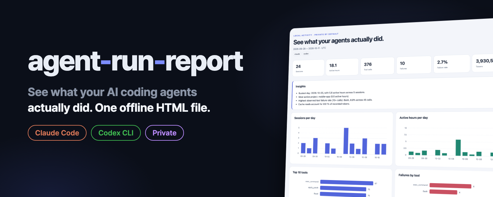
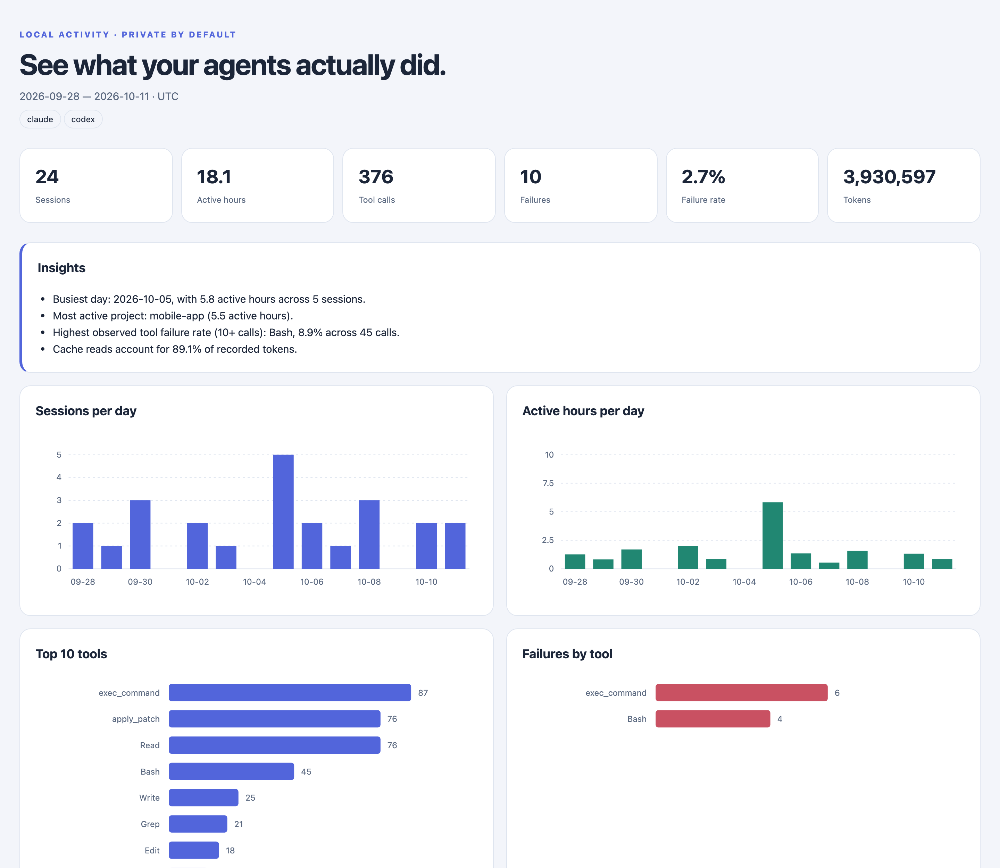
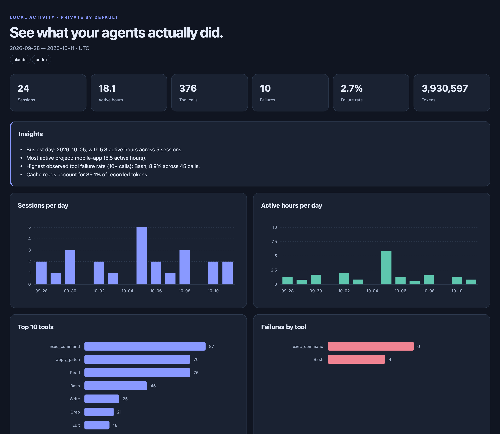

<p align="center"></p>

<p align="center">
  <a href="https://github.com/kks0488/agent-run-report/actions/workflows/ci.yml"></a>
  <a href="LICENSE"></a>
  
  =3.9">
</p>

<p align="center"><strong>English</strong> · <a href="README.ko.md">한국어</a></p>

<h2 align="center">See what your AI coding agents actually did.</h2>

<p align="center">For developers using Claude Code and OpenAI Codex CLI who want to understand their sessions, tool usage, failures, and recorded tokens. Turn local logs into one offline HTML file, with no runtime dependencies.</p>

<p align="center"></p>

<table>
  <tr>
    <td width="50%"><strong>Two agents, one report</strong><br>Read Claude Code and OpenAI Codex CLI JSONL logs. Filter by date, source, or project.</td>
    <td width="50%"><strong>Activity at a glance</strong><br>Daily sessions, active time, tokens, tool calls, failures, and project totals.</td>
  </tr>
  <tr>
    <td><strong>Explore offline</strong><br>Search and sort sessions, expand details, and follow your system’s light or dark appearance. All styles, charts, and scripts are embedded.</td>
    <td><strong>Private by default</strong><br>No uploads. Prompts and tool inputs/outputs stay out of exports. Titles and file paths require explicit opt-in.</td>
  </tr>
</table>

## Quick start

Requires Python 3.9 or newer. Install with [pipx](https://pipx.pypa.io/):

```sh
pipx install git+https://github.com/kks0488/agent-run-report
agent-run-report --demo --out demo-report.html
```

Or install with pip in your Python environment:

```sh
pip install git+https://github.com/kks0488/agent-run-report
python3 -m agent_run_report --demo --out demo-report.html
```

Or run directly from a clone without installing the package:

```sh
git clone https://github.com/kks0488/agent-run-report.git
cd agent-run-report
python3 -m agent_run_report --demo --out demo-report.html
```

Open `demo-report.html` locally to explore without any agent logs. The bundled demo contains **24 synthetic sessions across 14 fixed days (2026-09-28 through 2026-10-11)**, using five fake projects and both agents. It includes quiet days, a busy day, and a little subagent activity; it reads no personal logs and does not depend on today’s date.

Generate a report from your own logs:

```sh
python3 -m agent_run_report --since 7d --out report.html
python3 -m agent_run_report --source codex --project sample-api --since 2026-10-01 --until 2026-10-11 --out codex-report.html
python3 -m agent_run_report --since 30d --out report.html --json report.json
```

## Usage and options

Both `agent-run-report` (after installation) and `python3 -m agent_run_report` accept the same options.

| Option | Behavior / default |
| --- | --- |
| `-h`, `--help` | Show help and exit. |
| `--since 7d\|30d\|YYYY-MM-DD` | Start at a relative day count or UTC date. Default: last 30 days; with `--demo`: all fixture dates. |
| `--until YYYY-MM-DD` | Include this entire UTC day. Default: no upper bound. |
| `--source all\|claude\|codex` | Select an agent. Default: `all`. |
| `--project SUBSTR` | Case-insensitive substring match against the project’s full working-directory path. |
| `--out PATH` | HTML output. Default: `agent-run-report.html`. |
| `--json PATH` | Also export aggregated JSON with the same privacy settings. Use a different path from `--out`. |
| `--claude-dir PATH` | Claude Code log directory or individual JSONL file. Default: `~/.claude/projects`. |
| `--codex-dir PATH` | Codex CLI log directory or individual JSONL file. Default: `~/.codex/sessions`. |
| `--include-titles` | Opt in to recorded Claude session titles, which may contain private text. Hidden by default. |
| `--full-paths` | Opt in to project paths and touched file paths; replace the current user’s home directory with `~`. |
| `--open` | Open the finished local HTML file in your default browser. Off by default. |
| `--demo` | Read only bundled synthetic logs, ignoring personal log directory options. |
| `--version` | Print the installed version and exit. |

Create the output directory first; the CLI writes files, not parent directories. No matching sessions produces a diagnostic and exit code `1`.

## How it works

The parser streams local JSONL files, aggregates metrics, applies privacy settings, and renders a single HTML file. Claude logs are discovered recursively as `*.jsonl` under `~/.claude/projects`; Codex logs as `rollout-*.jsonl` under `~/.codex/sessions`. Directory overrides also accept a single file. File modification times prefilter date searches; event timestamps determine the included activity.

These log formats are **undocumented and may change**. The parser is defensive: it skips malformed lines, ignores unknown record types and unsupported fields, and tolerates missing values. Reports reflect recognized records, so missing or changed fields can make counts incomplete.

| Metric | Definition |
| --- | --- |
| Sessions | Unique `(source, session ID)` pairs with recognized events in the selected period. A session spanning days appears on each observed day; daily session counts need not sum to the session total. |
| Active time | Per session: sort unique event timestamps, then sum `min(gap, 300 seconds)` for consecutive events. Overlapping sessions are summed; this is recorded agent activity, not human work time. A single-event session has zero active time. |
| Tool calls | Recognized Claude `tool_use` blocks and Codex function/custom tool calls, deduplicated by call ID where available within a parsed log. |
| Failures | Explicit `is_error: true`, structured failed/error statuses, nonzero exit codes, or recognized shell exit markers in tool results. Codex error events also count, including unattributed errors. Repeated failures with the same call ID count once within a parsed log. The word “error” alone is insufficient. |
| Failure rate | Recorded failures ÷ recorded tool calls, or zero when there are no calls. Unattributed errors are included, so this is not a strict probability of a call failing. |
| Tokens | Recorded uncached input + output + cache reads + cache writes. Claude message usage snapshots are deduplicated per message ID using increases only. Codex cumulative counters use positive increases above the previous high-water mark; last-usage records are a fallback when totals are absent. Codex cached input is subtracted from input before being counted separately. |
| Files touched | Distinct paths recognized in edit/write/notebook operations and patch headers; not every file read or shell-side edit. Names stay hidden by default. |
| Subagent activity | Claude sidechain records; Codex records marked as subagent activity plus recognized spawn/Task/Agent calls. This counts activity signals, not unique subagents. |

All dates and daily buckets use **UTC**; quiet days between the first and last observations appear with zero activity. Token charts combine cache reads and writes, while session details and JSON keep them separate. **There is deliberately no dollar cost estimate:** prices change, and recorded token counts alone do not establish your bill.

## Privacy

Report generation reads local logs and writes local files. It makes no network requests, and the generated HTML uses embedded SVG, CSS, and JavaScript with no external resources. Installing the package and viewing this README’s badges are separate network activities.

By default, both HTML and optional JSON omit prompt text, assistant text, tool inputs/outputs, session titles, full project paths, and touched file names. Project basenames, shortened session IDs, models, timestamps, and aggregate counts remain visible. `--include-titles` and `--full-paths` opt in to the named fields; home-directory replacement is not complete anonymization. Review a report before sharing it.

## Dark mode

The report follows your system’s appearance automatically.

<p align="center"></p>

## Project layout

```text
agent-run-report/
├── agent_run_report/
│   ├── __init__.py       # Version
│   ├── __main__.py       # python -m entry point
│   ├── cli.py            # Options and local file output
│   ├── parsers.py        # Defensive Claude / Codex readers
│   ├── metrics.py        # Aggregation and privacy boundary
│   ├── render.py         # Standalone HTML, SVG, CSS, JavaScript
│   └── demo/
│       ├── claude/       # Synthetic JSONL sessions
│       └── codex/        # Synthetic JSONL rollouts
├── tests/test_report.py
├── .github/workflows/ci.yml
├── pyproject.toml
├── README.md
├── README.ko.md
└── LICENSE
```

## Run tests

From the repository root; no test dependencies are needed:

```sh
python -m unittest discover -s tests
python -m agent_run_report --demo --out /tmp/r.html
```

CI runs these commands on Ubuntu with Python **3.9, 3.11, and 3.13**, on pushes and pull requests. Tests cover parsing, deduplication, date filters, active-time accounting, privacy, rendering, CLI behavior, and demo diversity.

## Roadmap — not built yet

- More log-format variants backed by synthetic regression fixtures.
- Direct comparison between two reporting periods.

## FAQ

**Do I need an API key or a running agent?** No. Existing local logs are sufficient, and `--demo` works without any logs.

**Why did it find no sessions?** Check your directories, widen `--since`, or remove `--project`. The default window is 30 days. Only recognized JSONL records are counted; use directory overrides for custom log locations.

**Why don’t the totals match my provider’s dashboard?** This reports recognized local usage records, not billing data. Missing logs, format changes, filtering, and cache accounting can affect totals. No dollar estimate is made.

**Can I share the HTML?** It is self-contained and works offline. Default exports still reveal project basenames, model names, timestamps, and counts; review them before sharing, especially when using opt-in flags.

## Contributing

Issues and pull requests are welcome. For parser changes, include a small **synthetic** fixture or test case and the expected metrics; never attach personal logs or secrets. Run the tests and demo command above, and keep both READMEs in sync with implemented behavior.

## License

[MIT](LICENSE) © 2026 Kyoungsoo Kim.
